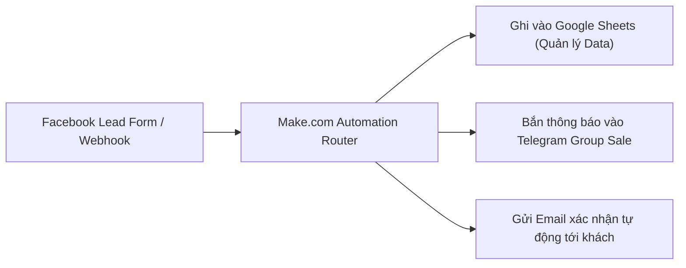

# Comprehensive Practical Guides & Community Posts (2026-10-18)
## Offers: Make.com, Hostinger, ElevenLabs

This document contains deep-dive tutorial and review posts optimized for multi-channel distribution (Facebook Group discussions, LinkedIn articles, Substack newsletters, and SEO blog posts).

---

## Post 1: Make.com — Hướng Dẫn Tự Động Hóa Quy Trình Bán Hàng & Chăm Sóc Khách Hàng (Zero Code)

- **Target Persona**: Chủ shop kinh doanh online, solopreneur, chuyên viên vận hành (Operations/Marketing) tại các doanh nghiệp vừa và nhỏ (SMBs).
- **Funnel Stage**: Solution-Aware / High Consideration (MOFU -> BOFU)
- **Primary Channels**: Facebook Group chuyên ngành (No-Code Vietnam, Cộng đồng Marketing), LinkedIn, Substack
- **Tracking URL**: `http://localhost:8000/go/make?subid=fb_group_guide_lead_sync&utm_source=facebook&utm_medium=article`

### Hook / Tiêu Đề Bài Viết:
> **"Tại sao các agency và shop online đang dần bỏ Zapier để chuyển sang Make.com? Hướng dẫn tự động hóa 3 kịch bản cứu sống 20 giờ mỗi tuần."**

### Nội Dung Bài Viết:

#### 1. Nỗi đau nhập liệu thủ công trong kinh doanh online
Nếu bạn đang kinh doanh trực tuyến, kịch bản quen thuộc này chắc chắn đã từng làm bạn mệt mỏi:
- Khách để lại số điện thoại trên quảng cáo Facebook hoặc form website.
- Bạn hoặc nhân viên phải mở từng tin nhắn, bôi đen, copy và paste vào một bảng tính Google Sheets.
- Sau đó lại phải mở Zalo hoặc phần mềm tổng đài để nhắn tin/gọi điện chào khách.

**Hậu quả là gì?**
1. **Chậm trễ**: Khách hàng trực tuyến có tỷ lệ phản hồi cao nhất trong 5 phút đầu tiên sau khi điền form. Sau 30 phút, tỷ lệ chốt giảm hơn 50%.
2. **Sai sót**: Nhập nhầm số, sót khách, trùng lặp dữ liệu giữa các nhân viên sale.
3. **Lãng phí chi phí nhân sự**: Bạn đang trả lương cho một nhân sự có tư duy chỉ để làm công việc copy-paste của một cái máy.

---

#### 2. Make.com là gì và vì sao lại vượt trội hơn các giải pháp cũ?
Make.com (tiền thân là Integromat) là nền tảng tự động hóa tích hợp không cần viết mã (No-Code iPaaS). Điểm khác biệt lớn nhất của Make so với Zapier nằm ở 3 điểm cốt lõi:
- **Giao diện Visual Trực Quan**: Thay vì danh sách dòng phẳng nhàm chán, Make hiển thị các module kết nối dạng vòng tròn tương tác trực tiếp, cho phép phân nhánh logic (Routers), lọc điều kiện (Filters), và vòng lặp (Iterators) cực kỳ tự nhiên.
- **Tiết kiệm chi phí gấp 3-5 lần**: Trong khi Zapier tính phí theo từng "task" với giá khá đắt đỏ, Make tính theo "Operations". Gói miễn phí của Make cung cấp sẵn **1.000 operations/tháng**, đủ cho phần lớn các quy trình cơ bản của một cá nhân hoặc shop khởi nghiệp.
- **Khả năng xử lý dữ liệu phức tạp**: Tự động bóc tách mảng JSON, đổi định dạng ngày tháng của Việt Nam, tính toán giá trị đơn hàng ngay trong luồng mà không cần viết script riêng.

---

#### 3. Hướng dẫn thiết lập kịch bản tự động hóa chỉ trong 10 phút

##### Bước 1: Tạo tài khoản Make miễn phí
Truy cập qua liên kết chính thức: [Đăng Ký Make.com Miễn Phí (1.000 tác vụ)](http://localhost:8000/go/make?subid=fb_group_guide_lead_sync). Chỉ cần email hoặc tài khoản Google là bạn có thể bắt đầu ngay mà không cần thẻ tín dụng.

##### Bước 2: Tạo kịch bản mới (Create a new scenario)
- Bấm vào nút tím **Create a new scenario**.
- Chọn module đầu tiên: **Webhooks** -> Chọn *Custom Webhook*. Make sẽ cung cấp một đường link URL đặc biệt. Bạn dán link này vào Form trên website hoặc ứng dụng thu thập data.

##### Bước 3: Kết nối Google Sheets
- Bấm vào dấu `+` để thêm module thứ hai: **Google Sheets** -> Chọn *Add a Row*.
- Đăng nhập tài khoản Google và chọn bảng tính quản lý đơn hàng.
- Nối các trường thông tin: Cột Tên -> Tên khách từ Webhook; Cột SĐT -> Số điện thoại từ Webhook.

##### Bước 4: Bắn thông báo về Telegram
- Thêm module thứ ba: **Telegram Bot** -> Chọn *Send a Text Message*.
- Nhập Bot Token (tạo miễn phí từ @BotFather trong 1 phút) và Chat ID của nhóm kinh doanh.
- Nội dung tin nhắn: `"Khách mới [Họ Tên] - [SĐT] vừa đăng ký! Sale trực chiến ngay nhé!"`.

##### Bước 5: Bật kịch bản (Scheduling: Immediately)
- Bấm **Save** và gạt công tắc kịch bản sang **ON**. Từ thời điểm này, toàn bộ quy trình sẽ chạy ngầm 24/7/365 với độ trễ dưới 1 giây.

---

#### 4. Kêu Gọi Hành Động (CTA) & Tài Liệu Tặng Kèm
Nếu bạn muốn trải nghiệm tự động hóa để giải phóng bản thân khỏi những tác vụ lặp lại nhàm chán:
👉 **[Nhận Tài Khoản Make.com Miễn Phí 1.000 Tác Vụ/Tháng Tại Đây](http://localhost:8000/go/make?subid=fb_group_guide_lead_sync)**  
*(Hãy để lại bình luận "TEMPLATE" nếu bạn muốn mình gửi file blueprint JSON của kịch bản trên để import vào tài khoản và dùng luôn nhé!)*

---

### Tuyên Bố Minh Bạch (Affiliate Disclosure):
> **Thông báo minh bạch**: Bài viết có chứa liên kết tiếp thị liên kết (affiliate link) đến dịch vụ của Make.com. Khi bạn tạo tài khoản hoặc nâng cấp gói trả phí qua đường dẫn này, tác giả có thể nhận được một khoản hoa hồng nhỏ để duy trì việc nghiên cứu và chia sẻ nội dung hữu ích, mà không làm phát sinh thêm bất kỳ chi phí nào cho bạn. Mọi đánh giá và hướng dẫn trong bài đều dựa trên trải nghiệm thực tế và khách quan.

---

## Post 2: Hostinger — "Xây Dựng Website Chuyên Nghiệp Trong 1 Buổi Tối: Lộ Trình Từ Con Số 0 Cho Người Không Biết Code"

- **Target Persona**: Freelancers làm dịch vụ, chuyên gia tư vấn, blogger, sinh viên năm cuối cần portfolio xin việc.
- **Funnel Stage**: Problem-Aware to Solution-Ready
- **Primary Channels**: Facebook trang cá nhân / Nhóm Freelancers Việt Nam, Blog WordPress cá nhân
- **Tracking URL**: `http://localhost:8000/go/hostinger?subid=freelancer_site_guide&utm_source=facebook&utm_medium=post`

### Hook / Mở Đầu Bài Viết:
> **"Nếu bạn đang làm Freelance hoặc kinh doanh dịch vụ mà vẫn gửi cho khách hàng một file PDF CV hay link Google Drive, bạn đang tự đánh mất 50% cơ hội nhận dự án giá cao."**

### Nội Dung Trọng Tâm:
Một website cá nhân có tên miền riêng (`tenban.com`) mang lại sự tin cậy vượt bậc so với hồ sơ gửi qua email thông thường:
1. **Định vị uy tín**: Khách hàng sẵn sàng trả mức thù lao cao gấp đôi cho một chuyên gia có trang web bài bản trình bày dự án đã làm (case studies).
2. **Khách hàng tự tìm đến**: Website tối ưu chuẩn SEO giúp bạn nhận được các liên hệ chất lượng mà không cần đi rải hồ sơ.
3. **Chi phí hiện nay đã quá rẻ**: Thay vì chi 10 triệu cho đơn vị thiết kế web, bạn có thể tự làm với chi phí chỉ khoảng **59.000 VNĐ / tháng** thông qua nền tảng Hostinger (bao gồm trọn gói: Hosting tốc độ cao + Tên miền .com miễn phí 1 năm + Chứng chỉ bảo mật SSL trọn đời).

### Bảng So Sánh Chi Phí & Lựa Chọn:

| Tiêu Chí | Thuê Ngoài Làm Web | Tự Dựng Với Hostinger AI / WordPress |
| :--- | :--- | :--- |
| **Chi phí ban đầu** | 7.000.000đ - 15.000.000đ | ~700.000đ / cả năm đầu (bao gồm tên miền) |
| **Thời gian triển khai** | 2 đến 4 tuần chờ đợi | 15 đến 30 phút tự thao tác |
| **Khả năng chỉnh sửa** | Mỗi lần sửa nội dung phải nhờ lập trình viên | Sửa trực tiếp bằng giao diện kéo-thả trực quan |
| **Quyền sở hữu** | Thường bị phụ thuộc bên thứ 3 | Hoàn toàn làm chủ dữ liệu và tài khoản hosting |

### Link Ưu Đãi Độc Quyền:
👉 **[Kích Hoạt Gói Hostinger Kèm Miễn Phí Tên Miền .COM Tại Đây](http://localhost:8000/go/hostinger?subid=freelancer_site_guide)**

---

## Post 3: ElevenLabs — "Cách Tạo Giọng Đọc AI Đạt Độ Tự Nhiên 99% Cho Kênh YouTube / Podcast"

- **Target Persona**: Nhà sáng tạo nội dung số (Content Creators), người làm video dạng faceless, podcast creators.
- **Funnel Stage**: Discovery / Awareness (TOFU)
- **Primary Channels**: Cộng đồng sáng tạo nội dung AI, TikTok Community, Threads
- **Tracking URL**: `http://localhost:8000/go/elevenlabs?subid=threads_ai_voice_review&utm_source=threads&utm_medium=post`

### Nội Dung Ngắn Gọn (Threads / Carousel Post):
1. **Sự thật về các kênh YouTube/TikTok faceless**: Hơn 60% các kênh review phim và tóm tắt sách tiếng nước ngoài hiện nay đều không dùng micro thu âm thật mà sử dụng công nghệ Text-to-Speech thế hệ mới của **ElevenLabs**.
2. **Tại sao không phải công cụ khác?** Model *Multilingual v2* của ElevenLabs có khả năng giữ hơi thở, nhấn nhá trọng âm tiếng Việt mượt mà đến mức 9/10 người nghe không nhận ra đó là giọng đọc nhân tạo.
3. **Cách bắt đầu**: Truy cập tạo tài khoản gói Free với **10.000 ký tự mỗi tháng** để thử nghiệm dự án đầu tiên mà không tốn chi phí.
4. 👉 **Trải nghiệm giọng đọc ElevenLabs miễn phí**: [http://localhost:8000/go/elevenlabs?subid=threads_ai_voice_review](http://localhost:8000/go/elevenlabs?subid=threads_ai_voice_review)
