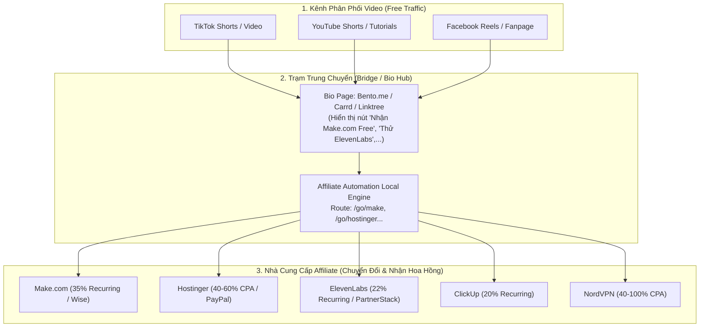

# Hướng Dẫn Kích Hoạt Kênh & Đăng Ký Tài Khoản Affiliate (Onboarding Guide)

Tài liệu này cung cấp lộ trình thực chiến từng bước dành cho **Người Vận Hành (Human Operator)** để tạo lập kênh phân phối video, đăng ký mạng lưới thanh toán, và đăng ký các chương trình Affiliate hàng đầu mà hệ thống tự động hóa đã nghiên cứu và chuẩn bị sẵn nội dung.

---

## 1. Kiến Trúc Kênh Phân Phối & Điều Hướng (Traffic Architecture)

Do Antigravity tuân thủ nguyên tắc an toàn (không tự động đăng nhập, không chi tiêu tiền, không post bài trực tiếp), bạn chỉ cần thiết lập hạ tầng phân phối theo mô hình sau:



### Xử lý rào cản tài khoản mới:
- **TikTok dưới 1.000 followers chưa gắn được clickable link bio**:
  - *Giải pháp 1*: Nâng cấp lên Business Account (Tài khoản doanh nghiệp) - nhiều khu vực cho phép gắn link ngay ở phần Website/Bio.
  - *Giải pháp 2*: Đặt short domain dễ nhớ (ví dụ `tenban.com/tools` hoặc `bento.me/tenban`) viết trực tiếp lên profile bio.
  - *Giải pháp 3*: Kêu gọi hành động: "Bình luận 'TOOL', mình gửi link nhận ưu đãi qua inbox" (hoặc dẫn sang YouTube/Zalo Group).
- **YouTube Shorts**: Cho phép gắn link liên kết đến video dài hơn (Related Video) hoặc ghim link trực tiếp trong Pinned Comment.

---

## 2. Thiết Lập Hạ Tầng Thanh Toán Quốc Tế (Payout Infrastructure)

Trước khi được duyệt affiliate, các mạng lưới sẽ yêu cầu phương thức thanh toán để chuyển tiền về Việt Nam:

### Bước 1: Tài Khoản Wise (Bắt buộc cho Make.com)
- **Truy cập**: [https://wise.com](https://wise.com)
- **Loại tài khoản**: Personal Account (Cá nhân).
- **Xác minh (KYC)**: Căn cước công dân (CCCD) hoặc Hộ chiếu (Passport) + chụp ảnh khuôn mặt.
- **Ưu điểm**: Nhận tiền USD/EUR từ Make.com, quy đổi trực tiếp sang VNĐ và rút về tài khoản ngân hàng nội địa (Vietcombank, Techcombank, MB,...) với tỷ giá liên ngân hàng và phí cực thấp (~0.4%).

### Bước 2: Tài Khoản PayPal (Dành cho Hostinger, CJ, ShareASale)
- **Truy cập**: [https://www.paypal.com](https://www.paypal.com)
- **Loại tài khoản**: Personal hoặc Premier.
- **Liên kết**: Thẻ Visa/Mastercard debit (ACB, Techcombank, VPBank...) và tài khoản ngân hàng nội địa để rút tiền.

---

## 3. Quy Trình Đăng Ký Từng Chương Trình Affiliate

### 1. Make.com Affiliate Program (Ưu tiên số 1 - Hoa hồng 35% trọn 12 tháng)
- **Link đăng ký**: [https://www.make.com/en/affiliate-program](https://www.make.com/en/affiliate-program)
- **Thời gian xét duyệt**: 1 - 2 ngày làm việc.
- **Phương thức thanh toán**: Wise (Tối thiểu $100 và có tối thiểu 3 khách hàng trả phí đầu tiên).
- **Mẫu nội dung trả lời đơn đăng ký**:
  - *Promotion Methods*: "Educational tutorials, workflow automation guides, and short-form video demonstrations (TikTok & YouTube Shorts) targeting digital marketers, solopreneurs, and small agencies."
  - *Website / Channel URL*: Link kênh TikTok / YouTube hoặc trang Notion chia sẻ kiến thức của bạn.
  - *Experience*: "Experienced in building no-code integrations and workflow automations."

### 2. ElevenLabs Affiliate Program (Ưu tiên số 2 - 22% trọn 12 tháng)
- **Link đăng ký**: Đăng ký qua nền tảng [PartnerStack ElevenLabs](https://elevenlabs.io) (mục Footer > Affiliate Program).
- **Nền tảng quản lý**: PartnerStack.
- **Phương thức thanh toán**: PayPal hoặc Stripe (ngưỡng tối thiểu chỉ $10).
- **Mẫu câu trả lời**: "Creating content around AI voices, text-to-speech workflows, study productivity, and audio dubbing for content creators."

### 3. Hostinger Affiliate Program (Ưu tiên số 3 - 40% đến 60% CPA)
- **Link đăng ký**: [https://www.hostinger.com/affiliates](https://www.hostinger.com/affiliates) (hoặc qua Impact.com).
- **Phương thức thanh toán**: PayPal (tối thiểu $100) hoặc Wire Transfer (tối thiểu $500).
- **Mẫu câu trả lời**: "Publishing step-by-step guides on setting up personal portfolios, AI landing pages, and WordPress blogs with cost-effective hosting."

### 4. ClickUp & NordVPN
- **ClickUp**: Đăng ký qua PartnerStack (20% recurring cho năm đầu tiên).
- **NordVPN**: Đăng ký qua Impact Radius hoặc CJ Affiliate (40% - 100% CPA).

---

## 4. Mẫu Email / Đơn Ứng Tuyển Chuẩn (Application Template)

Khi đăng ký các mạng lưới affiliate (Impact, PartnerStack, ShareASale), hãy sao chép và điều chỉnh mẫu sau để tỷ lệ duyệt đạt cao nhất:

```text
Subject: Affiliate Application - [Your Name / Channel Name]

Dear Partnership Team,

I am applying for your affiliate program. I create educational and tutorial content focused on AI tools, productivity software, and automation workflows.

1. Content & Traffic Strategy:
   - Primary Channels: TikTok, YouTube Shorts, and educational blog guides.
   - Audience: Digital creators, freelancers, and small business operators looking to streamline workflows.
   - Format: Real-case walkthroughs, problem-solution shorts, and honest tool comparisons with transparent affiliate disclosures.

2. Compliance & Quality:
   - Strict adherence to trademark bidding restrictions (no brand-jacking on paid search).
   - Clear FTC/local affiliate disclosures on all published assets.
   - Focus on user value and retention rather than spam tactics.

Channel / Hub Link: [Điền link TikTok / YouTube / Bento.me của bạn]
Contact: [Điền email của bạn]

Looking forward to collaborating with your team!

Best regards,
[Your Name]
```

---

## 5. Cập Nhật Link Vào Hệ Thống Tự Động Hóa

Sau khi được phê duyệt và nhận link affiliate chính thức từ các nền tảng:

1. Mở file cấu hình [`config/links.json`](file:///c:/Projects/affiliate-automation/config/links.json).
2. Tìm chương trình tương ứng (ví dụ: `make`, `hostinger`, `elevenlabs`).
3. Thay thế giá trị `"needs_verification"` tại mục `"affiliate_id"` bằng ID hoặc Referral Code của bạn:
   ```json
   "make": {
     "name": "Make.com",
     "destination_url": "https://www.make.com/en/register",
     "affiliate_param": "ref",
     "affiliate_id": "YOUR_ACTUAL_REF_ID",
     "target_subid": "tiktok_organic"
   }
   ```
4. Khi chạy dashboard local (`python scripts/serve_dashboard.py`), bất kỳ lượt truy cập nào vào:
   - `http://localhost:8000/go/make`
   - `http://localhost:8000/go/hostinger`
   sẽ tự động điều hướng 302 đến link affiliate chính thức với đầy đủ mã giới thiệu và UTM tracking, đồng thời ghi nhận số lượt click vào [`metrics/daily/click_log.json`](file:///c:/Projects/affiliate-automation/metrics/daily/click_log.json).
