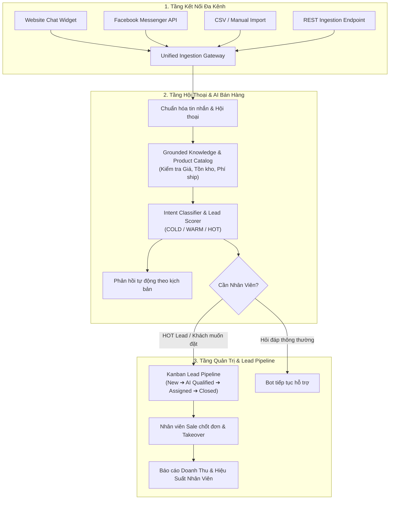
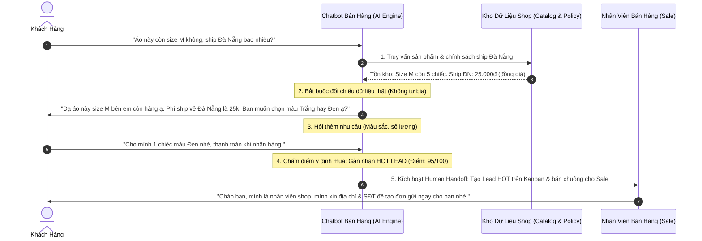
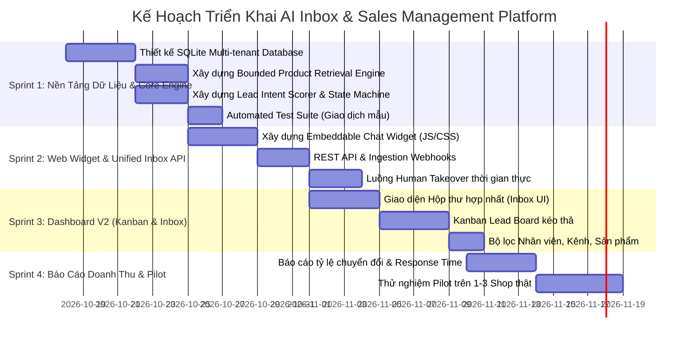

# Kế Hoạch Triển Khai: AI Inbox & Sales Management Platform

> **Định vị sản phẩm**: Nền tảng quản lý hội thoại tập trung và chuyển đổi Lead bằng AI cho Shop bán hàng và Agency tại Việt Nam — Tự động trả lời chuẩn xác theo kho dữ liệu, chấm điểm khách nóng, phân quyền nhân viên và đo lường doanh thu trên từng kênh.

---

## 1. Phân Chia Trách Nhiệm & Khả Năng Tự Động Hóa

Bạn hỏi: *"Giờ theo hướng này thì mình cần làm gì, bạn hỗ trợ được mình tự động hóa hết không?"*

Dưới đây là bảng phân định ranh giới tự động hóa 100% và phần việc duy nhất người vận hành cần làm:

| Hạng mục | Khả năng tự động hóa (Antigravity & Codex) | Việc Người Vận Hành cần làm |
| :--- | :--- | :--- |
| **Kiến trúc & Cơ sở dữ liệu** | **100% Tự động**: Thiết kế schema đa người dùng (Multi-tenant), quan hệ Customer - Conversation - Lead - Order - Staff. | Không cần làm gì. |
| **Chatbot Bán hàng (Core AI)** | **100% Tự động**: Xây dựng thuật toán 5 bước: Hiểu câu hỏi -> Truy vấn sản phẩm (Grounded RAG) -> Hỏi thêm nhu cầu -> Chấm điểm Lead -> Trigger Human Handoff. | Không cần làm gì. |
| **Quy tắc Chống Bịa Đặt (Zero-Hallucination)** | **100% Tự động**: Code bộ lọc cứng: Chặn hoàn toàn AI tự bịa giá, tồn kho, phí ship hoặc tự giảm giá ngoài danh mục. | Cung cấp danh mục sản phẩm mẫu (hoặc file Excel). |
| **Hệ thống Quản lý Lead (Kanban Pipeline)** | **100% Tự động**: Tự động chuyển đổi hội thoại thành Lead Card, phân loại New ➔ AI Qualified ➔ Assigned ➔ Won/Lost. | Nhân viên kéo thẻ hoặc chốt đơn thực tế. |
| **Website Chat Widget** | **100% Tự động**: Viết widget nhúng 1 dòng mã (JavaScript/CSS), hỗ trợ WebSockets/REST API chat trực tiếp. | Dán mã widget vào website nếu muốn test live. |
| **Dashboard UI (Command Center)** | **100% Tự động**: Giao diện trực quan gồm Unified Inbox (hộp thư tập trung), Kanban Lead Board, Quản lý sản phẩm, Báo cáo phễu. | Sử dụng và đưa ra feedback giao diện. |
| **Kết nối Facebook Page / Zalo OA** | **Hệ thống code sẵn API Adapter & Webhook receiver**. | Cấp App ID / Page Token chính thức từ Meta & Zalo (theo chính sách bảo mật). |

---

## 2. Kiến Trúc Luồng Dữ Liệu & State Machine

---

## 3. Thiết Kế 5 Bước Của Chatbot Bán Hàng (Sales AI Engine)

Chatbot được đóng gói logic nghiêm ngặt để đạt tỷ lệ chốt tối đa mà không gây rủi ro bán hàng:

---

## 4. Lộ Trình Triển Khai 4 Tuần (MVP Delivery Roadmap)

### Chi tiết các Sprint:
1. **Sprint 1 (Ngay hôm nay)**:
   - Data Layer: Workspaces, Customers, Conversations, Messages, Products, Leads, Staff.
   - Core Engine: Bounded Product Search, Rule-based Intent/Score Classifier, Lead Generator.
   - Unit tests chứng minh 100% độ chính xác: Test câu hỏi có hàng, câu hỏi không có hàng, câu hỏi đòi giảm giá.
2. **Sprint 2**:
   - Widget nhúng web 1 dòng code: Khách bấm vào chat, gửi tin nhắn, nhận phản hồi ngay lập tức.
   - Ingestion API: Cho phép nhận tin nhắn từ Facebook/Zalo qua Webhook.
3. **Sprint 3**:
   - Dashboard giao diện đẹp:
     - Cột 1: Danh sách hội thoại (lọc khách HOT, khách chờ phản hồi).
     - Cột 2: Cửa sổ chat 2 chiều (Bot trả lời hoặc Sale nhảy vào takeover).
     - Cột 3: Hồ sơ khách & Lead Pipeline trực tiếp.
4. **Sprint 4**:
   - Báo cáo số liệu thực: Số lead tạo ra, tỷ lệ chốt, nhân viên nào phản hồi nhanh nhất, doanh thu ghi nhận.

---

## 5. Quy Tắc Kỹ Thuật Bất Di Bất Dịch (Core Guardrails)
1. **Zero Hallucination**: AI không bao giờ được tự sinh ra giá, số lượng tồn kho hay hứa hẹn giao hàng nếu không có trong cơ sở dữ liệu.
2. **Deterministic Attribution**: Mọi đơn hàng / Lead Won phải truy vết được bắt nguồn từ kênh nào và hội thoại nào.
3. **Local-First & Lightweight**: Khởi chạy bằng Python chuẩn, không đòi hỏi hạ tầng cồng kềnh, chi phí vận hành siêu rẻ.
