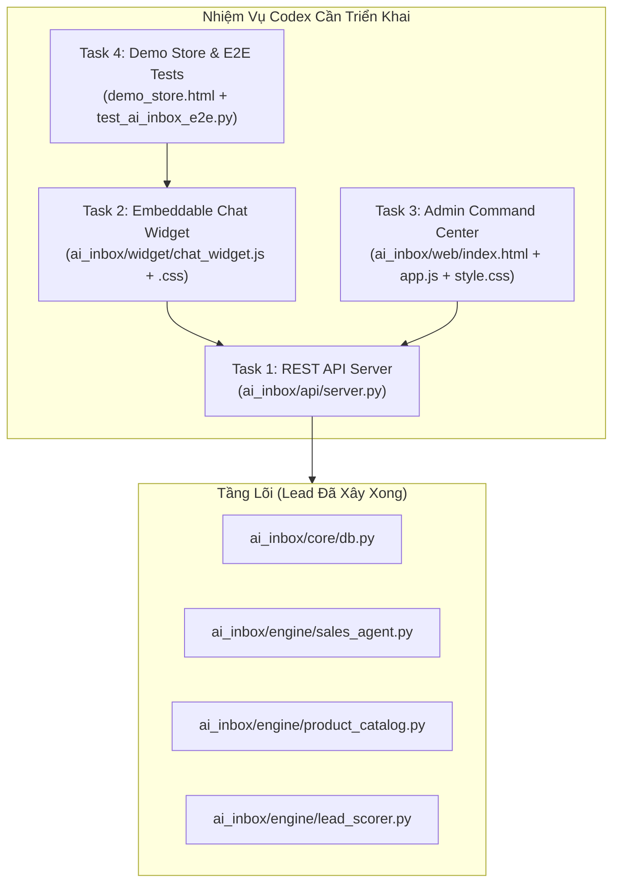

# BẢN GIAO VIỆC & KẾ HOẠCH TRIỂN KHAI DÀNH CHO CODEX
**Người giao việc**: Lead Architect (Antigravity)  
**Người thực thi**: Developer / Execution Agent (Codex)  
**Dự án**: AI Inbox & Sales Management Platform (Local-First MVP)  
**Trạng thái hiện tại**: Tầng Core Data & Sales Engine 5 bước đã hoàn thành và đạt 100% test tại `ai_inbox/core/` và `ai_inbox/engine/`.

---

## 1. MỤC TIÊU CÔNG VIỆC CỦA CODEX
Codex có nhiệm vụ xây dựng tầng **Giao Tiếp (API Server)**, **Widget Chat Nhúng Web (Embeddable Widget)** và **Giao Diện Quản Trị Bán Hàng (Admin Dashboard)** để hoàn thiện hệ thống chạy cục bộ (Local-First) trước khi đóng gói lên production.

---

## 2. DANH SÁCH 4 TASK CỤ THỂ CHO CODEX

### TASK 1: Xây Dựng REST API Server Cục Bộ
- **Đường dẫn file**: `ai_inbox/api/server.py`
- **Yêu cầu kỹ thuật**:
  - Dùng thư viện chuẩn Python 3.13 (`http.server`, `json`, `urllib.parse`) để giữ hệ thống siêu nhẹ, zero-dependency.
  - Hỗ trợ CORS đầy đủ (để widget và dashboard gọi API mượt mà).
  - Khởi chạy ở cổng mặc định: `http://127.0.0.1:8080/`.
- **Các Endpoint bắt buộc phải có**:
  1. `POST /api/widget/message`: Nhận tin nhắn từ widget khách hàng. Gọi `SalesAgent.handle_incoming_message()`, trả về câu trả lời của bot, điểm lead, và cờ `human_handoff_triggered`.
  2. `GET /api/widget/history?conversation_id=<id>`: Lấy toàn bộ lịch sử tin nhắn của cuộc trò chuyện để hiển thị lại trên widget.
  3. `GET /api/dashboard/inbox`: Lấy danh sách hội thoại cho Admin. Hỗ trợ lọc theo `status` (`bot_handling`, `assigned_human`, `closed`) và lọc khách `HOT`.
  4. `GET /api/dashboard/leads/kanban`: Lấy danh sách Lead nhóm theo 6 cột phễu:
     - `new` (Mới)
     - `ai_qualified` (AI đã phân loại)
     - `assigned` (Đã giao Sale)
     - `contacted` (Đang liên hệ)
     - `negotiating` (Thương lượng)
     - `won` / `lost` (Chốt đơn thành công / Thất bại)
  5. `POST /api/dashboard/leads/<id>/stage`: Cập nhật trạng thái phễu khi Sale kéo thả thẻ trên Kanban.
  6. `POST /api/dashboard/conversations/<id>/takeover`: Nhân viên Sale bấm nút "Can thiệp / Chốt đơn" ➔ Chuyển trạng thái hội thoại sang `assigned_human`, tạm dừng bot.
  7. `POST /api/dashboard/conversations/<id>/reply`: Nhân viên Sale gửi tin nhắn người thật vào cuộc trò chuyện.
  8. `GET /api/dashboard/metrics`: Trả về số liệu: Tổng hội thoại, Số Lead HOT, Tỷ lệ chốt đơn (%), Thời gian phản hồi trung bình.

---

### TASK 2: Xây Dựng Website Chat Widget Nhúng 1 Dòng Code
- **Đường dẫn file**:
  - `ai_inbox/widget/chat_widget.js`
  - `ai_inbox/widget/chat_widget.css`
- **Yêu cầu kỹ thuật**:
  - Viết bằng Vanilla JS/CSS thuần, tự đóng gói (self-contained), không xung đột CSS của website khách.
  - Khi nhúng `` vào bất kỳ trang web nào:
    1. Hiện nút tròn bong bóng chat ở góc phải bên dưới màn hình.
    2. Bấm vào thì mở khung chat hiện đại, thân thiện, có âm thanh nhẹ hoặc hiệu ứng rung khi nhận tin nhắn.
    3. Lưu `conversation_id` trong `localStorage` để khi F5 tải lại trang khách không bị mất tin nhắn cũ.
    4. Có hiệu ứng "Đang nhập..." (Typing indicator) khi bot đang xử lý câu trả lời.
    5. Khi nhân viên sale can thiệp (`assigned_human`), hiện banner thông báo: *"Nhân viên tư vấn đã vào hỗ trợ bạn"*.

---

### TASK 3: Xây Dựng Giao Diện Admin Command Center
- **Đường dẫn file**:
  - `ai_inbox/web/index.html`
  - `ai_inbox/web/app.js`
  - `ai_inbox/web/style.css`
- **Yêu cầu giao diện**: Thiết kế tối giản, trực quan, chuyên nghiệp, hỗ trợ 3 tab làm việc chính:
  1. **Tab 1 — Unified Inbox (Hộp Thư Tập Trung)**:
     - *Cột bên trái*: Danh sách hội thoại theo thứ tự thời gian. Khách nào có nhãn `HOT` thì hiện huy hiệu đỏ nổi bật và còi báo động.
     - *Cột ở giữa*: Cửa sổ đọc tin nhắn 2 chiều. Có nút xanh nổi bật: **[⚡ Can thiệp / Takeover]** để Sale vào chốt đơn. Phía dưới có ô nhập tin nhắn để Sale gõ trả lời trực tiếp.
     - *Cột bên phải*: Hồ sơ khách hàng tóm tắt: Tên, SĐT, Sản phẩm quan tâm, Điểm ý định mua (0-100), Phễu hiện tại.
  2. **Tab 2 — Lead Board (Kanban Kéo Thả)**:
     - 6 cột trực quan theo đúng quy trình bán hàng: `Mới` ➔ `AI Đã Lọc` ➔ `Bàn Giao Sale` ➔ `Đang Chat` ➔ `Chốt Đơn Thành Công (Won)` ➔ `Thất Bại (Lost)`.
     - Cho phép bấm chuyển trạng thái thẻ hoặc kéo thả.
  3. **Tab 3 — Báo Cáo Hiệu Quả (Sales Analytics)**:
     - 4 thẻ số liệu to rõ: Tổng khách hỏi, Số khách HOT, Tỷ lệ chuyển đổi đơn hàng, Doanh thu ước tính.

---

### TASK 4: Tạo Trang Demo Shop & Bộ Test E2E Tự Động
- **Đường dẫn file**:
  - `ai_inbox/web/demo_shop.html`: Một trang bán hàng mẫu (Áo Polo, Đồ gia dụng) có nhúng sẵn Widget Chat để người dùng hoặc sếp bấm vào test thử ngay trên trình duyệt.
  - `tests/test_ai_inbox_e2e.py`: Script tự động hóa gửi HTTP Request kiểm tra toàn bộ luồng từ Widget ➔ API ➔ Bot ➔ Lead ➔ Staff Takeover.
- **Tiêu chí nghiệm thu (Acceptance Criteria)**:
  - Chạy lệnh `python tests/test_ai_inbox_e2e.py` phải trả về `ALL E2E TESTS PASSED (100%)`.
  - Khởi chạy server bằng lệnh: `python -m ai_inbox.api.server` hoặc `python scripts/serve_inbox.py`.
  - Mở trình duyệt `http://localhost:8080/demo` là chat được ngay, mở `http://localhost:8080/admin` là xem được Dashboard.

---

## 3. NGUYÊN TẮC KỸ THUẬT DÀNH CHO CODEX (QUAN TRỌNG)
1. **Không phá vỡ logic Core đã pass test**: Kế thừa trực tiếp `SalesAgent` từ `ai_inbox/engine/sales_agent.py` và `get_connection` từ `ai_inbox/core/db.py`.
2. **Zero-Dependency**: Ưu tiên dùng thư viện chuẩn của Python và Vanilla JS/CSS để bất kỳ ai tải project về cũng chạy được ngay lập tức bằng 1 lệnh `python`.
3. **Local-First**: Mọi dữ liệu lưu trữ trực tiếp vào file SQLite `data/inbox.db`.
4. **Code sạch, có ghi chú rõ ràng**: Mỗi hàm API và component frontend cần có chú thích mục đích sử dụng.
